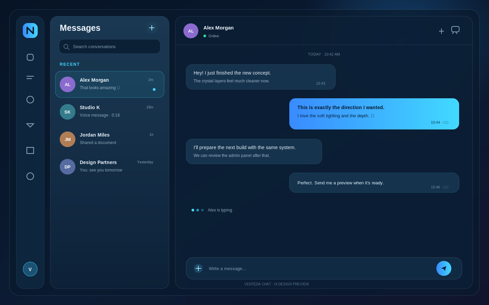
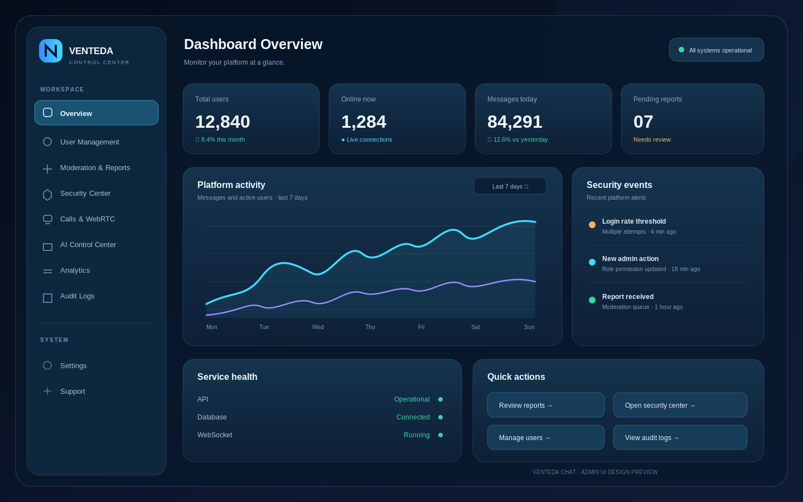

<div align="center">
  
  <h1>VENTEDA CHAT</h1>
  <p><strong>A self-hostable, real-time messaging platform built with FastAPI.</strong></p>
  <p>Private conversations · Live messaging · Voice & video signaling · Community stories · Admin control center</p>
  <p>
    
    
    
    
  </p>
</div>

---

## ✨ About

VENTEDA CHAT is a full-stack messaging application with a Python/FastAPI backend and a browser-based interface. It combines REST APIs, authenticated WebSockets, SQLAlchemy persistence, media uploads, WebRTC signaling, and a role-aware administration area in one project.

> **Project status:** This repository is prepared for public development and self-hosting experiments. Review the [security notes](SECURITY.md) and complete a deployment-specific security review before exposing an instance to the public internet.

## 🖼️ Interface previews

The images below are **illustrative design previews**, not screenshots captured from a running production instance. They show the intended visual direction and major interface areas.

### Messaging workspace

<p align="center">
  
</p>

### Administration dashboard

<p align="center">
  
</p>

## 🚀 Features

### Messaging and community

- Real-time messaging over authenticated WebSockets.
- Direct and group conversations with membership checks.
- Message attachments and voice-message uploads.
- One-to-one and group call signaling using WebRTC.
- Contacts, privacy-aware discovery, stories, and saved media.
- Message reactions and conversation-level actions supported by the current application.

### Administration

- Staff roles and server-side role checks.
- User search and account moderation tools.
- Reports and moderation workflows.
- Platform metrics and activity summaries.
- Administrative audit records and staff notes.
- Persisted login sessions with device/browser metadata and session revocation.
- Extended account controls and moderation utilities.

### Security foundations

- Password hashing with bcrypt.
- Signed JWT access tokens.
- Authenticated WebSocket connections.
- Conversation membership checks for private attachments.
- File extension and content-signature validation for supported uploads.
- Security response headers and explicit CORS origin configuration.
- Environment-based secrets and configuration.

## 🧰 Technology

| Layer | Technology |
|---|---|
| Backend | Python, FastAPI, Uvicorn |
| Database | SQLAlchemy 2.x (SQLite by default; configurable SQLAlchemy URL) |
| Validation | Pydantic v2, pydantic-settings |
| Authentication | JWT, bcrypt |
| Real-time | WebSockets |
| Calls | WebRTC signaling in the application |
| Frontend | HTML, CSS, JavaScript, Jinja2 templates |
| Tests | pytest, HTTPX |

## 📦 Requirements

- Python 3.10 or newer.
- A modern browser.
- Microphone/camera permissions for voice and video features.
- HTTPS for production deployments and secure browser media access.

## ⚡ Quick start

### 1. Get the source

```bash
git clone https://github.com/YOUR_USERNAME/venteda-chat.git
cd venteda-chat
```

Or download the ZIP from the GitHub repository and extract it.

### 2. Create and activate a virtual environment

**Windows PowerShell**

```powershell
py -3 -m venv .venv
.\.venv\Scripts\Activate.ps1
```

**macOS / Linux**

```bash
python3 -m venv .venv
source .venv/bin/activate
```

### 3. Install dependencies

```bash
python -m pip install --upgrade pip
pip install -r requirements-dev.txt
```

### 4. Configure the environment

Copy `.env.example` to `.env`:

```powershell
# Windows PowerShell
Copy-Item .env.example .env
```

```bash
# macOS / Linux
cp .env.example .env
```

Generate a strong secret key:

```bash
python -c "import secrets; print(secrets.token_urlsafe(64))"
```

Paste the generated value into `SECRET_KEY` in `.env`. Keep `.env` private and never commit it.

For local development, the defaults use SQLite and `http://localhost:3000`. Set `CORS_ORIGINS` to the exact origins used by your deployment. Set `COOKIE_SECURE=true` when serving over HTTPS.

### 5. Start the application

```bash
python main.py
```

Open:

- App: <http://localhost:3000>
- Admin interface: <http://localhost:3000/admin>
- OpenAPI docs: <http://localhost:3000/api/docs>
- ReDoc: <http://localhost:3000/api/redoc>
- Health endpoint: <http://localhost:3000/api/health>

## 👑 Create the first owner

The public registration endpoint does not create an owner account. Use the bootstrap command from the project root:

```bash
python main.py --bootstrap-owner --username owner --password "Use-A-Long-Unique-Password" --email owner@example.com
```

Choose a unique password and do not reuse the example value.

## 🐳 Docker

Build the image:

```bash
docker build -t venteda-chat .
```

Run it with a persistent upload volume and your private environment file:

```bash
docker run --name venteda-chat \
  --env-file .env \
  -p 3000:3000 \
  -v venteda-uploads:/app/uploads \
  --restart unless-stopped \
  venteda-chat
```

For production, put the service behind a TLS-terminating reverse proxy, configure the trusted origins, and use a persistent database and upload storage strategy.

## 🧪 Tests and quality checks

Install development dependencies:

```bash
pip install -r requirements-dev.txt
```

Run the test suite:

```bash
pytest -v
```

Compile-check Python sources:

```bash
python -m compileall -q app main.py
```

GitHub Actions runs the test suite on supported Python versions for pushes and pull requests.

## 🗂️ Project structure

```text
.
├── app/
│   ├── api/              # REST API routers
│   ├── cli/              # Owner bootstrap command
│   ├── core/             # Settings and database setup
│   ├── models/           # SQLAlchemy models
│   ├── schemas/          # Pydantic schemas
│   ├── security/         # Tokens, password hashing, upload checks, rate limits
│   ├── services/         # Application services
│   └── websocket/        # WebSocket connection manager
├── docs/
│   └── screenshots/     # Illustrative interface previews
├── static/
│   ├── css/              # Stylesheets
│   ├── images/           # Logos and demo assets
│   └── js/               # Frontend modules
├── templates/            # Jinja2 pages
├── tests/                # Automated tests
├── uploads/              # Runtime uploads (not committed)
├── .env.example          # Safe configuration template
├── Dockerfile
├── main.py
└── requirements*.txt
```

## 🔐 Important security limitations

- **No end-to-end encryption is implemented or claimed.** Do not describe private conversations as E2EE-protected.
- The current staff API includes administrative message-inspection and live-feed endpoints that can return private message text. Restrict staff accounts and deployment access carefully; disable or redesign these endpoints if that access is not appropriate for your service.
- The built-in rate limiter is in-memory and is not shared between multiple workers or server instances. Use a shared rate-limit store before horizontal scaling.
- WebRTC signaling is included, but reliable calls across restrictive networks generally require a properly configured TURN service.
- Configure HTTPS, secure cookies, backups, database permissions, upload storage, logging, and monitoring for your own deployment.
- Do not expose API documentation publicly unless that is an intentional deployment decision.
- See [SECURITY.md](SECURITY.md) before deploying.

## 🤝 Contributing

Bug reports, focused improvements, tests, and documentation contributions are welcome. Read [CONTRIBUTING.md](CONTRIBUTING.md) before opening a pull request.

## 📄 License

This project is distributed under the MIT License. See [LICENSE](LICENSE).

---

<div align="center">
  <strong>VENTEDA CHAT</strong><br />
  <sub>Built for real-time conversations. Designed for continuous improvement.</sub>
</div>
